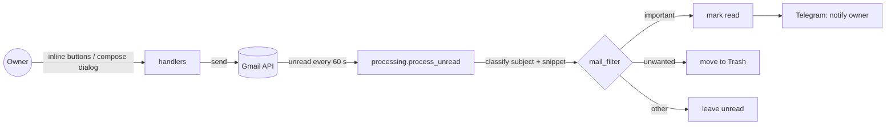

# Gmail → Telegram Bot


Async Telegram bot that watches a Gmail inbox: important mail is pushed to Telegram, promo mail goes to Trash, and the owner can write and send e-mails straight from the chat. In daily use it handled about 150 e-mails a day.

## Example notification

```
🚨 Важное письмо в Gmail

От: Bank <noreply@bank.example>
Тема: Оплата заказа №1042
Кратко: Платёж на 2 490 ₽ прошёл успешно…

[🔄 Проверить сейчас] [📊 Статус]
[⏸ Приостановить автопроверку]
[✉️ Написать письмо]
```

## How it works



| Module | Responsibility |
|---|---|
| `mailbot/config.py` | Reads and validates settings from `.env` |
| `mailbot/gmail_client.py` | OAuth 2.0, Gmail calls, exponential backoff on 403/429 |
| `mailbot/processing.py` | Pure inbox logic: classify → action → report (no network inside) |
| `mailbot/mail_filter.py` | Keyword classification, important wins over unwanted |
| `mailbot/handlers.py` | aiogram router: control panel, status, compose → confirm → send (FSM) |
| `mailbot/app.py` | Logging, start-up, background inbox loop, polling |

## Design decisions
- **Owner-only.** The router filters every update by the configured chat id; other chats are ignored.
- **Nothing is deleted.** Promo mail is moved to Trash (recoverable for 30 days), never deleted permanently.
- **Event loop is never blocked.** The Gmail client is synchronous and always called through `asyncio.to_thread`.
- **Quota-friendly.** 0.5 s pause between messages and backoff of 2, 3, 5, 9, 17 s on rate-limit errors.
- **No global state.** Runtime state lives in a `Monitor` object passed to the handlers.
- **Logs, not prints.** Standard `logging`; e-mail recipients and bodies are never written to the log.
- **Confirmation before sending.** The compose dialog shows a preview and sends only after an explicit button press.

## Setup
```bash
python -m venv .venv && source .venv/bin/activate   # Windows: .venv\Scripts\activate
pip install -r requirements.txt
cp .env.example .env                                 # fill in your values
python bot.py
```
1. Create a bot with [@BotFather](https://t.me/BotFather) and put its token into `.env`.
2. In Google Cloud Console enable the Gmail API, create an OAuth client of type *Desktop app* and save it as `credentials.json` in the project root. The first run opens a browser for consent and creates `token.json`.

| Variable | Required | Description |
|---|---|---|
| `TELEGRAM_BOT_TOKEN` | yes | Bot token from BotFather |
| `TELEGRAM_CHAT_ID` | yes | Numeric id of the only chat allowed to control the bot |
| `CHECK_INTERVAL` | no | Seconds between inbox checks (default 60, minimum 15) |
| `TZ_NAME` | no | Time zone for the status screen (default `Asia/Yekaterinburg`) |
| `LOG_LEVEL` | no | `INFO` by default |

## Tests
```bash
pip install -r requirements-dev.txt
ruff check . && pytest --cov=mailbot
```
The Gmail API is replaced with fakes and mocks, so tests need no network or credentials. They cover classification, the per-category actions (mark read / Trash / leave), the backoff policy, settings validation, HTML escaping and the owner notification flow. CI runs them on Python 3.11–3.13.

## Security
Secrets live only in `.env`, `credentials.json` and `token.json` — all git-ignored. OAuth scopes are limited to `gmail.modify` and `gmail.send`.

## Limitations and next steps
- Keyword rules are simple; a small classifier trained on labelled mail would cut false positives.
- FSM state is in memory, so an unfinished draft is lost on restart (Redis storage would fix that).
- Polling Gmail every minute; Gmail push notifications via Pub/Sub would be more efficient.

License: MIT
